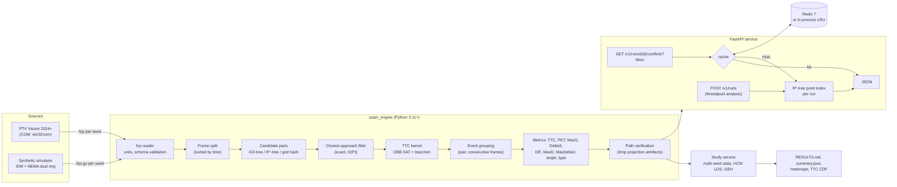
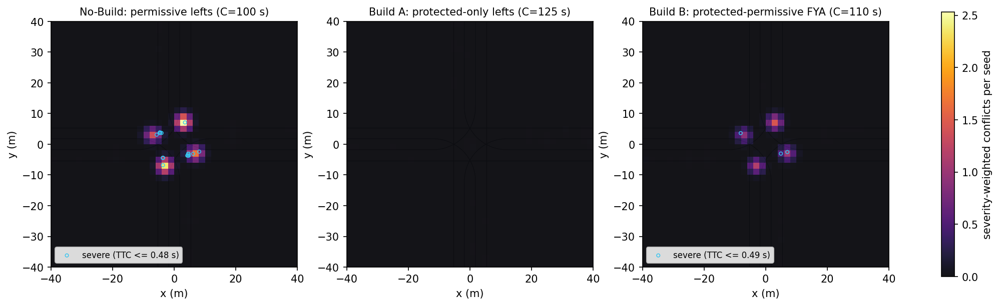

# safety-ssam-trajectory-engine

**Proactive intersection safety from microsimulation trajectories.** An FHWA SSAM-equivalent
surrogate safety engine for PTV Vissim vehicle records (`.fzp`): vectorised TTC/PET conflict
detection, R\*-tree / KD-tree spatial indexing, projection-artefact filtering, multi-seed
statistics, severity heatmaps and an async query API.

**Headline (10 seeds per scenario, 95% CI, synthetic test bed):** at a four-leg signalized
intersection, protected-permissive flashing-yellow-arrow phasing cut crossing conflicts by
**50%** and severe conflicts (TTC ≤ 0.5 s) by **82%** versus permissive-only lefts, at a cost of
**+11 s/veh** control delay (LOS C → D). Protected-only phasing removed crossing conflicts
entirely but pushed the intersection to **LOS E (57 s/veh)**. The detector processes
~320k-480k trajectory rows per seed in about 2 s, and API spatial queries run at
**p99 = 2.9 ms** with a warm cache (6.0 ms cold, in-process).

---

## 1. Problem formulation

Crash-based safety analysis needs 3-5 years of crash history and cannot evaluate a design that
has not been built. Agencies therefore use **surrogate safety measures** from microsimulation:
near-misses whose time-to-collision (TTC) falls below a threshold. FHWA's Surrogate Safety
Assessment Model (SSAM, FHWA-HRT-08-051) is the reference tool, but it is a desktop
application that processes one `.trj` file at a time and is hard to put in an automated
pipeline.

This engine reproduces the SSAM methodology in a library/CLI/API that:

* reads Vissim vehicle records directly (metric or imperial; `.fzp` or `.fzp.gz`);
* processes ~500k trajectory rows per seed in a few seconds on a laptop;
* removes a known SSAM failure mode (false conflicts from straight-line projection of turning
  vehicles) and reports how many it removed;
* runs No-Build vs. Build studies across 10 random seeds with confidence intervals,
  required-replication checks, Welch t-tests and KS tests;
* serves results through a FastAPI service with spatial (bounding-box) queries and caching.

**Demonstration study.** A four-leg signalized intersection (35 mph approaches, exclusive left
lanes) comparing left-turn phasing alternatives, the classic safety-vs-delay trade-off an
agency asks a consultant to quantify:

| Scenario | Phasing | Cycle |
|---|---|---|
| No-Build | 2-phase, all lefts permissive (yield to opposing through) | 100 s |
| Build A | 8-phase NEMA dual ring, lead-lead **protected-only** lefts | 125 s |
| Build B | 8-phase NEMA dual ring, lead-lead **protected-permissive** lefts (flashing yellow arrow, MUTCD) | 110 s |

> **Data provenance.** No Vissim licence was available while building this repository, so the
> study uses the bundled synthetic microsimulator (`ssam_engine.sim`), which writes
> Vissim-format `.fzp` files. The detector, statistics and API are agnostic to the source;
> `ssam-engine vissim-run` produces the same inputs from a real Vissim network (see section 6).
> The synthetic simulator is a transparent test bed, **not** a calibrated Vissim model, so the
> results demonstrate the method rather than a design recommendation for a real site.

---

## 2. Architecture



**Concurrency model.** The detector is single-process and vectorised (NumPy). Studies fan out
(scenario, seed) jobs over a `ProcessPoolExecutor`. The API runs CPU-bound analysis in a
thread pool so the event loop keeps serving queries; query responses are serialised once and
cached as JSON strings (Redis when `SSAM_REDIS_URL` is set, otherwise a bounded TTL LRU).

### Spatial indexing complexity (per frame, n vehicles, k neighbours)

| Backend | Build | Query (all pairs) | Notes |
|---|---|---|---|
| `brute` | - | O(n²) | reference implementation |
| `grid` | O(n) | O(n·k) | cell = 2·r_max guarantees neighbours lie in adjacent cells |
| `kdtree` (default) | O(n log n) | O(n log n + P) | `scipy.spatial.cKDTree.query_pairs` |
| `rtree` | O(n log n) | O(n log n + P) | libspatialindex **R\*-tree**, bulk-loaded, vectorised `intersection_v` |

All four return identical pair sets (property-tested in `tests/test_spatial.py`).

---

## 3. Methodology

### 3.1 Vehicle state from the vehicle record

For each sample, the footprint centre and heading come from the front/rear bumper coordinates:

$$\mathbf{p} = \tfrac12(\mathbf{f}+\mathbf{r}),\qquad \theta=\operatorname{atan2}(f_y-r_y,\;f_x-r_x),\qquad \mathbf{v}=s\,(\cos\theta,\sin\theta)$$

Each vehicle is an oriented rectangle of length $L$ and width $W$.

### 3.2 Time-to-collision (SSAM definition)

Both vehicles are projected forward at constant velocity. TTC is the first look-ahead time at
which the projected rectangles overlap:

$$\mathrm{TTC}(t)=\min\{\tau\in[0,\tau_{\max}] : \mathcal{R}_i(\mathbf{p}_i+\mathbf{v}_i\tau)\cap\mathcal{R}_j(\mathbf{p}_j+\mathbf{v}_j\tau)\neq\varnothing\}$$

Overlap uses the separating-axis theorem on the four box axes $\{\mathbf{u}_i,\mathbf{n}_i,\mathbf{u}_j,\mathbf{n}_j\}$:
boxes are separated if, for some axis $\mathbf{a}$,

$$|(\mathbf{c}_j-\mathbf{c}_i)\cdot\mathbf{a}| > \sum_{k\in\{i,j\}} \left(\tfrac{L_k}{2}|\mathbf{u}_k\cdot\mathbf{a}| + \tfrac{W_k}{2}|\mathbf{n}_k\cdot\mathbf{a}|\right)$$

**Pruning.** A pair can only collide within the horizon if its bounding circles (radius = half
diagonal $h$) come within reach. With relative position $\mathbf{r}$ and velocity $\mathbf{w}$, the
closest approach is exact:

$$\tau^\* = \operatorname{clip}\!\left(-\frac{\mathbf{r}\cdot\mathbf{w}}{\lVert\mathbf{w}\rVert^2},\,0,\,\tau_{\max}\right),\qquad
\text{keep if } \lVert\mathbf{r}+\mathbf{w}\tau^\*\rVert \le h_i+h_j$$

Survivors are sampled at 0.05 s and the first overlapping interval is bisected 5 times
(resolution ≈ 1.6 ms).

### 3.3 Conflict events and SSAM measures

Consecutive frames in which the same pair has $\mathrm{TTC}\le 1.5$ s form one event. Per event:

| Measure | Definition |
|---|---|
| TTC | minimum TTC over the event |
| PET | $\min\lvert t_a-t_b\rvert$ over all sample pairs where footprint $a(t_a)$ overlaps footprint $b(t_b)$: time between the first vehicle leaving shared space and the second entering it. Undefined (NaN) if the second vehicle never encroached, e.g. it stopped short |
| MaxS | maximum speed of either vehicle during the event |
| DeltaS | $\lVert\mathbf{v}_a-\mathbf{v}_b\rVert$ at minimum TTC |
| DR, MaxD | initial and maximum deceleration of the second vehicle |
| MaxDeltaV | $\max\left(\frac{m_b}{m_a+m_b},\frac{m_a}{m_a+m_b}\right)\Delta S$, perfectly inelastic collision, $m\propto L\cdot W$ |
| Type | heading difference $\phi$: rear-end $\phi<30°$, crossing $\phi>85°$, otherwise lane-change (SSAM defaults) |

Events with TTC = 0 (footprints already overlapping) are reported separately as simulated
overlaps and excluded from conflict totals, as is usual practice for microsimulation output.

### 3.4 Projection-artefact filter (beyond SSAM)

Straight-line projection is wrong for turning vehicles: a left-turner mid-arc "points at"
vehicles it will never reach, and SSAM counts those as conflicts. An event is kept only if either:

1. **Encroachment:** the actual footprints, inflated by 1.0 m, occupied common space within
   max PET (5 s) of each other; or
2. **On course:** both vehicles stayed within 1.0 m laterally of their projected rays for the
   TTC horizon. This means the projection was physically right and the collision was avoided by
   braking (the stop-short rear-end, which has no PET).

Events failing both are dropped and counted (`unverified_removed`) so the filter is auditable.

### 3.5 Delay, LOS and model checks

* **Control delay** per vehicle = (exit time - arrival time at the network edge) - free-flow
  travel time at the driver's desired speed, which includes queueing upstream of the entry.
  LOS uses HCM 7th Ed. Exhibit 19-8 thresholds (A ≤ 10, B ≤ 20, C ≤ 35, D ≤ 55, E ≤ 80 s/veh).
* **GEH** of served vs. demanded hourly volume per movement:
  $\mathrm{GEH}=\sqrt{2(M-C)^2/(M+C)}$, target < 5 for > 85 % of movements. This verifies demand
  loading only; it is not a field calibration.
* **Replications.** FHWA Traffic Analysis Toolbox Vol. III:
  $N \ge \left(t_{\alpha/2,N-1}\, s / (\varepsilon\,\bar{x})\right)^2$ with $\varepsilon = 15\%$, computed on
  total conflicts per scenario.

### 3.6 Synthetic simulator (test bed)

* Car following: Intelligent Driver Model,
  $\dot v = a\left[1-(v/v_0)^4-(s^\*/s)^2\right]$, $s^\* = s_0+vT+\frac{v\Delta v}{2\sqrt{ab}}$,
  with per-driver $v_0$, $T$, $a$, $b$ (cars and heavy vehicles).
* Signals: fixed-time NEMA TS2 dual ring, ring-barrier validated (equal barrier sums, legal
  barrier phases), MUTCD 3-6 s yellow; ITE-consistent 4 s yellows at 35 mph.
* Yellow onset: go if distance $< v t_r + v^2/(2b_s)$ with $t_r = 1$ s, $b_s = 3$ m/s².
* Permissive lefts: gap acceptance against opposing through traffic with a driver-specific
  critical gap $t_c\sim\mathcal N(4.5, 1.0)$ s truncated to [2.2, 8] s. The short-gap tail is what
  generates crossing conflicts.
* Measured discharge headway ≈ 2.0 s for through (≈ 1,800 vph) and ≈ 2.5 s for protected
  lefts (≈ 1,440 vph). Build-scenario splits were sized from these for v/c ≈ 0.8.

---

## 4. Results

Full generated report: [`results/left_turn_phasing/RESULTS.md`](results/left_turn_phasing/RESULTS.md).
Seeds 11, 23, 37, 41, 59, 67, 73, 89, 97, 101; 15-min analysis period after 5-min warm-up;
values are seed means ± 95% Student-t half-width; p from Welch's t-test vs. No-Build.

### 4.1 Safety and operations

| Metric (per 15 min) | No-Build: permissive | Build A: protected-only | Build B: protected-permissive FYA |
|---|---|---|---|
| Total conflicts (TTC ≤ 1.5 s) | 119.4 ± 10.8 | 29.1 ± 3.4 (−76%, p<0.001) | 72.3 ± 7.8 (−39%, p<0.001) |
| Crossing conflicts | 101.0 ± 9.2 | 0.3 ± 0.3 (−100%, p<0.001) | 50.4 ± 4.8 (−50%, p<0.001) |
| Rear-end conflicts | 18.4 ± 3.5 | 28.8 ± 3.3 (+57%, p<0.001) | 21.9 ± 3.5 (+19%, p=0.126) |
| Severe conflicts (TTC ≤ 0.5 s) | 1.1 ± 0.4 | 0.0 ± 0.0 | 0.2 ± 0.3 (−82%, p<0.001) |
| Mean MaxDeltaV (m/s), severity proxy | 4.31 ± 0.11 | 1.91 ± 0.06 (−56%) | 4.30 ± 0.10 (n.s.) |
| Intersection control delay (s/veh) | 30.9 ± 1.7 | 57.3 ± 3.6 (+85%) | 42.3 ± 3.7 (+37%) |
| **HCM 7 LOS** | **C** | **E** | **D** |



**Engineering reading.**

* Permissive lefts concentrate crossing conflicts at the four left-turn × opposing-through
  conflict points (heatmap, left panel). Every severe conflict sits there.
* Protected-only phasing removes them, but the longer cycle (125 s) and four critical phases
  raise rear-end conflicts (+57%, longer queues) and delay (LOS E). The left-turn movements
  themselves reach 67-78 s/veh.
* Protected-permissive (FYA) halves crossing conflicts and nearly eliminates severe ones
  while keeping the intersection at LOS D and the left turns at LOS B-C. The penalty moves
  to the minor-street through movements (NBT/SBT ≈ 56 s/veh), which is the next thing to
  re-optimise (split/cycle sweep) before recommending it.
* The two-sample KS test confirms the TTC distribution shifts under Build A
  (D = 0.60, p < 10⁻⁸⁰) but only marginally under Build B (D = 0.08, p = 0.005). FYA reduces
  how often conflicts occur, not how severe the remaining ones are (MaxDeltaV unchanged).

### 4.2 Model checks

| Check | No-Build | Build A | Build B |
|---|---|---|---|
| Movements with GEH < 5, worst seed (target ≥ 85%) | 88% | 88% | 88% |
| Max movement GEH, any seed | 6.49 | 6.49 | 7.08 |
| Seeds required for ±15% on total conflicts (10 run) | 6 | 8 | 7 |
| Raw TTC events per seed → removed as projection artefacts | 130.1 → 6.5 | 79.8 → 46.4 | 98.0 → 20.9 |
| Simulated overlaps (TTC = 0), excluded | 1.5 ± 1.6 | 0.0 | 0.1 ± 0.2 |

The single GEH > 5 per seed is always a low-volume left turn: one 15-minute Poisson draw,
scaled to an hourly rate, swings by ±20 vph. The projection filter matters most for
Build A: **58% of raw SSAM-style TTC events there are turning vehicles "pointing at" each
other on the protected left arcs**, which never come near each other. Raw SSAM would have
reported roughly 80 conflicts per 15 min for Build A instead of 29.

### 4.3 Performance (Windows 11 laptop, i5-1135G7, 8 GB, Python 3.12)

Candidate-pair generation per frame at constant density (2,000 veh/km²), median of 7 runs.
All backends return identical pairs:

| Vehicles in frame | brute | grid hash | **KD-tree** | R\*-tree |
|---|---|---|---|---|
| 50 | 0.09 ms | 0.49 ms | **0.06 ms** | 1.42 ms |
| 200 | 0.67 ms | 1.48 ms | **0.21 ms** | 6.08 ms |
| 1,000 | 32.4 ms | 9.96 ms | **0.90 ms** | 34.5 ms |
| 5,000 | - | 59.8 ms | **7.86 ms** | 211 ms |

The KD-tree is the default. The R\*-tree loses here because it must be rebuilt every 0.1 s
frame and its bulk load crosses the Python/C boundary per item. It is used where it fits: the
API's per-run static index over conflict locations.

API bounding-box query latency (2,000 random boxes, 147 indexed conflicts, in-process ASGI,
no network hop):

| | p50 | p95 | p99 |
|---|---|---|---|
| cold (cache miss: R\*-tree query + filter + serialise) | 3.2 ms | 5.1 ms | 6.0 ms |
| warm (cache hit) | 1.2 ms | 2.2 ms | 2.9 ms |

End to end, one seed (~400k rows) simulates in ~40 s and analyses in ~2 s.

---

## 5. Repository layout

```
safety-ssam-trajectory-engine/
├── configs/
│   ├── engine.yaml                  # SSAM thresholds + detector numerics
│   ├── study.yaml                   # No-Build vs Build A/B, 10 seeds
│   └── scenarios/                   # geometry, demand, NEMA timing, driver population
├── docker/
│   ├── Dockerfile                   # python:3.11-slim, non-root, healthcheck
│   └── docker-compose.yml           # API + Redis 7 (LRU, no persistence)
├── src/ssam_engine/
│   ├── core/                        # config, schema, geometry, TTC kernel, detector, HCM/GEH
│   ├── spatial/                     # pair finders (KD-tree, R*-tree, grid, brute) + point index
│   ├── io/fzp.py                    # Vissim vehicle-record reader/writer
│   ├── sim/                         # synthetic IDM + NEMA dual-ring intersection simulator
│   ├── services/                    # pipeline, statistics, heatmaps, report, benchmarks
│   ├── api/                         # FastAPI app, cache (Redis / LRU), run store, schemas
│   ├── vissim/com_runner.py         # multi-seed Vissim batch runner over COM
│   └── cli.py                       # `ssam-engine` command
├── tests/                           # pytest: analytic TTC/PET cases, backends, sim, API
├── results/left_turn_phasing/       # generated report, tables and figures
├── requirements.txt                 # pinned
└── pyproject.toml
```

---

## 6. Reproduce

```bash
python -m venv .venv && . .venv/bin/activate          # Windows: .venv\Scripts\activate
pip install -r requirements.txt && pip install --no-deps -e .
pytest                                                # 55 tests

# full study: 3 scenarios x 10 seeds, writes results/left_turn_phasing/
ssam-engine study configs/study.yaml --out results --workers 2

# analyse any Vissim vehicle record (imperial units example)
ssam-engine analyze my_run.fzp --config configs/engine.yaml --heatmap --out results/my_run

# benchmarks
ssam-engine bench-index --sizes 50 200 1000 5000
ssam-engine bench-api --fzp results/left_turn_phasing/data/baseline/seed11.fzp.gz --queries 2000

# API
ssam-engine serve --port 8000                         # or: docker compose -f docker/docker-compose.yml up --build
curl -F "file=@seed11.fzp.gz" http://localhost:8000/v1/runs
curl "http://localhost:8000/v1/runs/<run_id>/conflicts?min_x=-15&min_y=-15&max_x=15&max_y=15&conflict_type=crossing"
```

### Using real Vissim output

1. In the `.inpx`, enable *Evaluation > Configuration > Direct Output > Vehicle record* with at
   least `SIMSEC, NO, LANE\LINK\NO, LANE\INDEX, SPEED, ACCELERATION, COORDFRONTX, COORDFRONTY,
   COORDREARX, COORDREARY, LENGTH, WIDTH, VEHTYPE`, at resolution 10 steps/s.
2. Run seeds over COM (Windows, licensed Vissim, `pip install pywin32`):
   ```bash
   ssam-engine vissim-run --network corridor.inpx --seeds 1 2 3 4 5 6 7 8 9 10 \
       --period 4500 --warmup 900 --driving-behaviors '{"1": {"W99cc0": 1.5}}' --out data/vissim
   ```
3. Set `units.length: ft` and `units.speed: mph` in `configs/engine.yaml` for imperial networks,
   then run `ssam-engine analyze data/vissim/*.fzp`.

The COM runner was written against the Vissim COM object model (`LoadNet`, `Simulation.RunContinuous`,
`SetAttValue`), but it **has not been run against a licensed Vissim installation**. Attribute names
are collected in `vissim/com_runner.py::ATTR`; check them against *Help > COM API* for your
release. Calibrate the base model (Wiedemann 99 CC0-CC9, GEH and travel-time targets) before
drawing safety conclusions; conflicts from an uncalibrated model are not meaningful.

---

## 7. Limitations

* Synthetic demand is Poisson with no platoon progression; no pedestrians, right turns or lane changes.
* Surrogate conflicts are relative indicators. They rank alternatives; they do not predict crash
  frequency without a site-specific conflict-to-crash model (see FHWA-HRT-08-049).
* The projection filter thresholds (1.0 m buffer, 1.0 m lateral tolerance) are engineering choices,
  exposed in `configs/engine.yaml`; set `require_path_verification: false` to reproduce raw SSAM counts.
* API latency figures are in-process ASGI measurements (no network hop).

## References

* FHWA-HRT-08-051, *Surrogate Safety Assessment Model and Validation: Final Report* (2008).
* FHWA-HRT-04-040, *Traffic Analysis Toolbox Vol. III: Guidelines for Applying Traffic Microsimulation Modeling Software* (2019 update).
* *Highway Capacity Manual, 7th Edition*, TRB (2022), Chapter 19.
* *Manual on Uniform Traffic Control Devices*, FHWA (signal indications, yellow change and flashing yellow arrow provisions).
* Treiber, Hennecke & Helbing, "Congested traffic states in empirical observations and microscopic simulations," *Phys. Rev. E* 62 (2000).

## License

MIT
