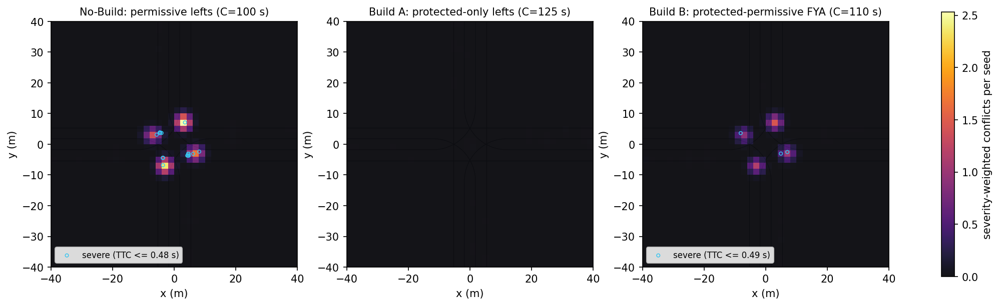
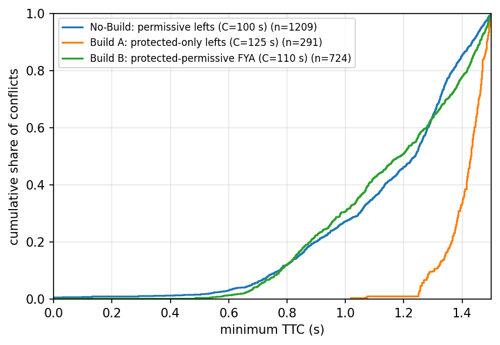

# Study results: `left_turn_phasing`

Seeds: 11, 23, 37, 41, 59, 67, 73, 89, 97, 101 (10 replications per scenario). Values are seed means with 95% Student-t confidence half-widths. SSAM thresholds: max TTC 1.5 s, max PET 5.0 s, rear-end < 30.0 deg, crossing > 85.0 deg.

## No-Build vs. Build alternatives

| Metric | No-Build: permissive lefts (C=100 s) | Build A: protected-only lefts (C=125 s) | Build B: protected-permissive FYA (C=110 s) | Change Build A (p) | Change Build B (p) |
|---|---|---|---|---|---|
| Total conflicts (TTC <= 1.5 s) per 15 min | 119.4 ± 10.8 | 29.1 ± 3.4 | 72.3 ± 7.8 | -76% (<0.001) | -39% (<0.001) |
| Crossing conflicts | 101.0 ± 9.2 | 0.3 ± 0.3 | 50.4 ± 4.8 | -100% (<0.001) | -50% (<0.001) |
| Rear-end conflicts | 18.4 ± 3.5 | 28.8 ± 3.3 | 21.9 ± 3.5 | +57% (<0.001) | +19% (0.126) |
| Lane-change / angle conflicts | 0.0 ± 0.0 | 0.0 ± 0.0 | 0.0 ± 0.0 | - (-) | - (-) |
| Severe conflicts (TTC <= 0.5 s) | 1.1 ± 0.4 | 0.0 ± 0.0 | 0.2 ± 0.3 | -100% (<0.001) | -82% (<0.001) |
| Simulated overlaps (TTC = 0, excluded above) | 1.5 ± 1.6 | 0.0 ± 0.0 | 0.1 ± 0.2 | -100% (0.062) | -93% (0.079) |
| Mean minimum TTC (s) | 1.15 ± 0.01 | 1.41 ± 0.01 | 1.15 ± 0.02 | +22% (<0.001) | -1% (0.522) |
| Median PET (s) | 0.60 ± 0.00 | 3.36 ± 0.29 | 0.60 ± 0.00 | +461% (<0.001) | +0% (1.000) |
| Mean MaxDeltaV (m/s) | 4.31 ± 0.11 | 1.91 ± 0.06 | 4.30 ± 0.10 | -56% (<0.001) | -0% (0.862) |
| Intersection control delay (s/veh) | 30.9 ± 1.7 | 57.3 ± 3.6 | 42.3 ± 3.7 | +85% (<0.001) | +37% (<0.001) |
| HCM 7 intersection LOS | C | E | D | | |

Two-sample KS test, pooled minimum TTC, Build A vs No-Build: D = 0.603, p = 7.71e-81.
Two-sample KS test, pooled minimum TTC, Build B vs No-Build: D = 0.080, p = 0.0053.

## Model checks

| Check | No-Build: permissive lefts (C=100 s) | Build A: protected-only lefts (C=125 s) | Build B: protected-permissive FYA (C=110 s) |
|---|---|---|---|
| Movements with GEH < 5 (worst seed) | 88% | 88% | 88% |
| Max movement GEH (all seeds) | 6.49 | 6.49 | 7.08 |
| Seeds needed for ±15% on total conflicts | 6 | 8 | 7 |
| Raw TTC events per seed (before verification) | 130.1 | 79.8 | 98.0 |
| Projection-only events removed per seed | 6.5 | 46.4 | 20.9 |
| Trajectory rows per seed | 323,375 | 484,524 | 391,832 |
| Detector runtime per seed (s) | 1.59 | 2.06 | 2.21 |

## Movement control delay and LOS (seed mean)

| Movement | No-Build: permissive lefts (C=100 s) | Build A: protected-only lefts (C=125 s) | Build B: protected-permissive FYA (C=110 s) |
|---|---|---|---|
| EBL | 24.6 s (C) | 67.2 s (E) | 19.5 s (B) |
| EBT | 34.7 s (C) | 46.3 s (D) | 38.2 s (D) |
| NBL | 22.4 s (C) | 74.9 s (E) | 27.6 s (C) |
| NBT | 25.2 s (C) | 57.7 s (E) | 56.3 s (E) |
| SBL | 21.4 s (C) | 77.7 s (E) | 28.8 s (C) |
| SBT | 25.8 s (C) | 60.9 s (E) | 55.5 s (E) |
| WBL | 27.0 s (C) | 76.8 s (E) | 20.1 s (C) |
| WBT | 41.2 s (D) | 49.1 s (D) | 41.6 s (D) |

